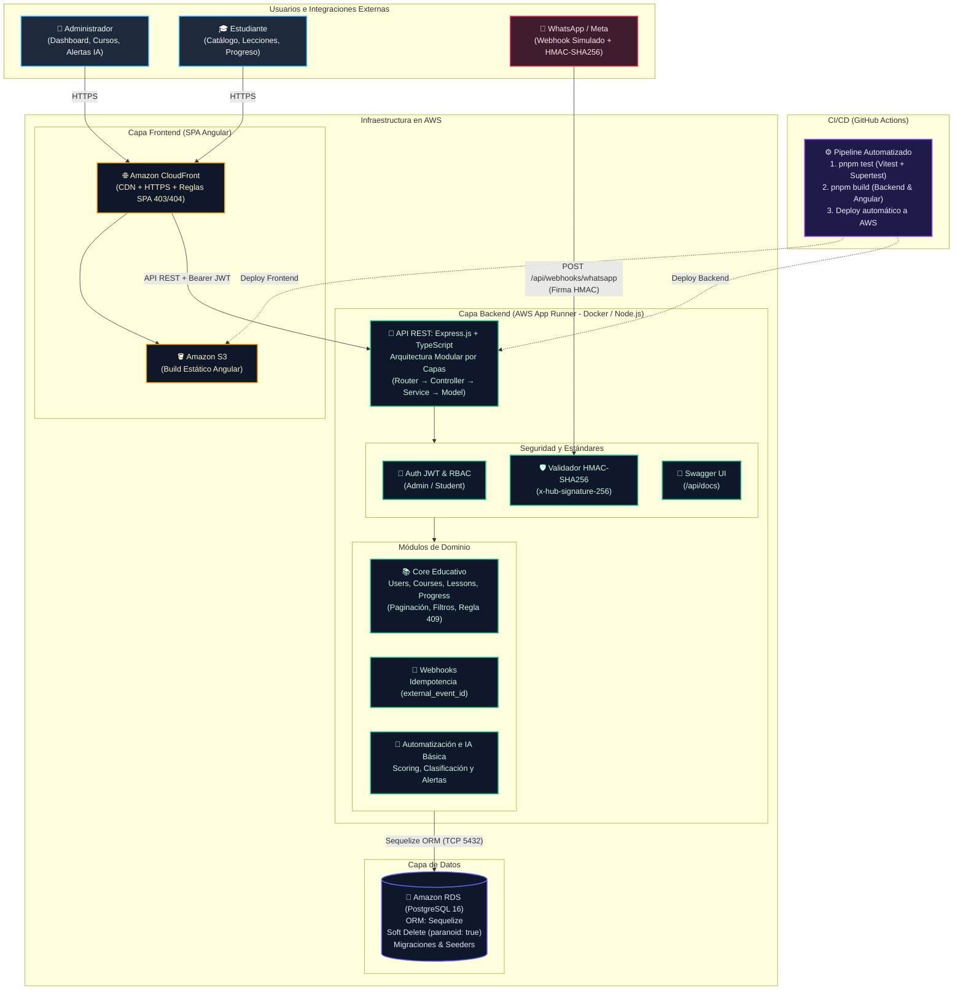

## Arquitectura del Sistema

> **Nota de escalamiento (Fase 2 en producción):** Para soportar alto volumen de eventos entrantes en Biz Nation sin bloquear el API principal, el módulo de webhooks se desacoplará incorporando **Amazon SQS** con una **Dead Letter Queue (DLQ)**. El endpoint responderá `200 OK` de inmediato tras validar la firma HMAC-SHA256 y encolar el payload, delegando a un *worker* los reintentos asíncronos con *backoff* exponencial, control de idempotencia y protección frente a caídas del proveedor.