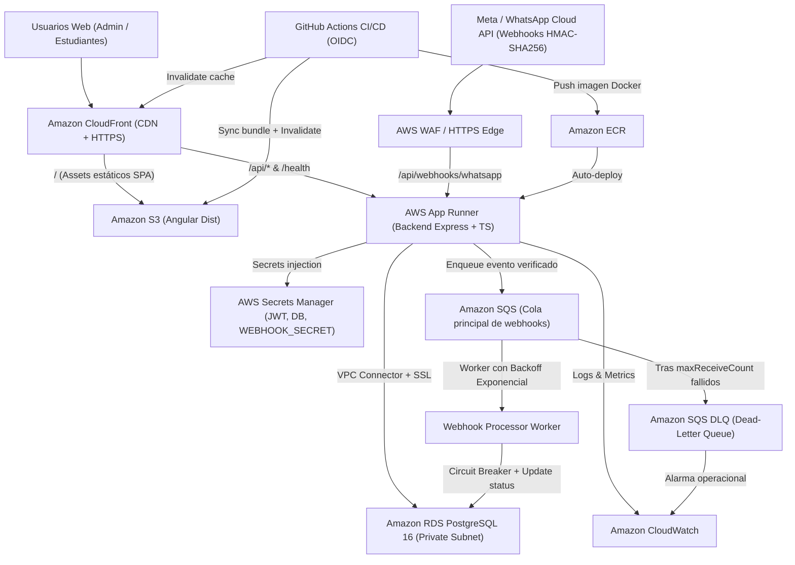

# Arquitectura AWS — Biz Nation

Este documento describe la arquitectura objetivo en **Amazon Web Services (AWS)** para el monorepo de Biz Nation (Angular SPA + API Express/TypeScript + PostgreSQL 16 + Webhooks/Automatización), la estimación de costos, la estrategia de CI/CD y el diseño resiliente para webhooks en producción.

---

## 1. Diagrama de Arquitectura

---

## 2. Servicios Elegidos y Justificación

| Servicio AWS | Rol en el sistema | Justificación técnica |
| --- | --- | --- |
| **Amazon S3 + CloudFront** | Hosting estático del build de Angular (`frontend/dist/frontend/browser`) y distribución global | Cero administración de servidores web; compresión Brotli/Gzip automática, HTTPS con ACM, Origin Access Control (OAC) y enrutamiento único de `/api/*` hacia el backend evitando problemas de CORS en producción (`apiUrl: '/api'`). |
| **AWS App Runner** | Ejecución del contenedor Docker multi-stage del backend (`backend/Dockerfile`) | Despliegue PaaS serverless basado en contenedores: TLS administrado, autoescalado horizontal por concurrencia, health checks nativos contra `GET /health` y conexión privada a RDS vía VPC Connector sin administrar instancias EC2 ni clústeres ECS complejos. *(Alternativa viable si se requiere IP fija o instancias reservadas: EC2 + ALB).* |
| **Amazon ECR** | Registro privado de imágenes Docker | Almacena de forma segura las imágenes construidas por GitHub Actions, con escaneo de vulnerabilidades y políticas de ciclo de vida para limpiar tags antiguos. |
| **Amazon RDS (PostgreSQL 16)** | Base de datos relacional administrada | Paridad exacta con el PostgreSQL 16 local (`docker-compose.yml`), backups automáticos, snapshots puntuales (PITR), cifrado en reposo (KMS) y SSL en tránsito (`DB_SSL=true`). |
| **AWS Secrets Manager** | Gestión de credenciales y secretos | Inyecta de forma segura `DATABASE_URL` / `DB_PASSWORD`, `JWT_SECRET`, `WEBHOOK_SECRET` y `WEBHOOK_VERIFY_TOKEN` en runtime sin exponer secretos en código ni archivos `.env`. |
| **Amazon SQS + DLQ** | Procesamiento asíncrono y resiliente de webhooks en producción | Desacopla la recepción HTTP rápida (`200 OK` a Meta) del procesamiento pesado/IA y garantiza reintentos con backoff exponencial y aislamiento de fallos en Dead-Letter Queue. |
| **Amazon CloudWatch** | Observabilidad centralizada | Recolecta logs JSON estructurados, métricas de latencia HTTP/5xx y alarmas sobre profundidad de la DLQ o saturación de RDS. |

---

## 3. Estimación de Costos Mensuales en AWS (`us-east-1`)

> Valores referenciales aproximados para una región estándar (`us-east-1`) comparando entorno de evaluación/capa gratuita (12 primeros meses) vs producción inicial baja-media.

| Servicio | Capa Gratuita / MVP Evaluación | Producción Inicial (Tráfico moderado) |
| --- | --- | --- |
| **Amazon S3** (assets Angular < 50 MB + requests) | \$0.00 *(Free Tier: 5 GB)* | ~\$0.50 – \$1.50 |
| **Amazon CloudFront** (transferencia < 50 GB/mes) | \$0.00 *(Always Free: 1 TB/mes)* | ~\$0.00 – \$5.00 |
| **AWS App Runner** (`0.25–1 vCPU`, `0.5–2 GB RAM`, escala a mínimo activo) | ~\$5.00 – \$12.00 *(no tiene free tier permanente de cómputo)* | ~\$25.00 – \$45.00 *(1 vCPU / 2 GB RAM continuo)* |
| **Amazon ECR** (< 500 MB imagen Alpine optimizada) | \$0.00 *(Free Tier: 500 MB/mes)* | ~\$0.10 – \$0.50 |
| **Amazon RDS PostgreSQL 16** (`db.t4g.micro`, 20 GB GP3, Single-AZ) | \$0.00 *(12 meses Free Tier: 750h `db.t3/t4g.micro`)* | ~\$15.00 – \$25.00 *(o ~\$32+ con Multi-AZ)* |
| **AWS Secrets Manager** (3–4 secretos) | ~\$1.20 – \$1.60 *(30 días trial, luego \$0.40/secreto)* | ~\$1.60 – \$2.00 |
| **Amazon SQS + CloudWatch** (< 1M requests SQS, logs básicos) | \$0.00 *(Always Free: 1M SQS requests)* | ~\$1.00 – \$5.00 |
| **Total Mensual Estimado** | **~\$6 – \$14 USD / mes** | **~\$43 – \$84 USD / mes** |

---

## 4. Estrategia de CI/CD (`.github/workflows/ci-cd.yml`)

1. **Integración Continua (en cada Push y Pull Request a `main`)**:
   - `backend-ci`: configura Node.js LTS desde `.node-version`, instala dependencias con `pnpm install --frozen-lockfile`, ejecuta `typecheck`, `build`, la suite `vitest + supertest` y valida la construcción de `backend/Dockerfile`.
   - `frontend-ci`: ejecuta pruebas unitarias Angular con Vitest (`ng test --watch=false`), compila el bundle de producción (`ng build`) y publica el artefacto `frontend/dist/frontend/browser`.
2. **Despliegue Continuo (solo en `push` a `main`, tras aprobación de checks)**:
   - Autenticación sin llaves estáticas mediante **GitHub OIDC** hacia un rol IAM (`AWS_DEPLOY_ROLE_ARN`).
   - **Backend**: build y push de la imagen multi-stage a Amazon ECR (`git sha` + `latest`) seguido de `aws apprunner start-deployment`.
   - **Migraciones**: en producción, ejecutar `pnpm --filter @biznation/backend db:migrate` como paso controlado previo al tráfico o tarea one-off dentro de la VPC antes de activar la nueva revisión.
   - **Frontend**: `aws s3 sync` con cache inmutable (`max-age=31536000`) para bundles con hash y `no-cache` para `index.html`, seguido de invalidación en CloudFront.

---

## 5. Estrategia de Producción para Webhooks (Resiliencia y Escalabilidad)

Aunque en esta prueba técnica `POST /api/webhooks/whatsapp` procesa el evento y lo clasifica en línea para simplificar el flujo local, en producción se aplica una arquitectura orientada a eventos:

1. **Verificación Rápida en Borde + Idempotencia Estricta**:
   - El endpoint valida inmediatamente `x-hub-signature-256` (`crypto.timingSafeEqual` sobre `rawBody`).
   - Verifica `external_event_id` contra el índice único parcial (`WHERE deleted_at IS NULL`) en `webhook_events`: si ya existe, responde **`200 OK`** sin encolar ni duplicar trabajo, absorbiendo reintentos duplicados de Meta.
   - Inserta el registro en estado `received`, encola el `webhook_event_id` en **Amazon SQS** y responde `200 OK` en `<100 ms` (evitando timeouts de Meta).
2. **Reintentos con Amazon SQS + Backoff Exponencial + DLQ**:
   - Un worker lee de la cola principal con `maxReceiveCount = 5`.
   - Si falla un paso transitorio (ej. timeout de DB o servicio de IA externo), el worker aplica **backoff exponencial con jitter** recalculando `ChangeMessageVisibility` (`30s -> 2m -> 8m -> 30m -> 2h`), incrementando `webhook_events.attempts` y registrando `error_log`.
   - Superados los 5 intentos, SQS mueve automáticamente el mensaje a la **Dead-Letter Queue (DLQ)** y dispara una alarma en CloudWatch para inspección y redrive controlado.
3. **Circuit Breaker para Fallos de Proveedores Externos**:
   - Cuando el worker invoca APIs externas (ej. envío de respuesta por WhatsApp Cloud API o servicio LLM externo), las llamadas se envuelven en un **Circuit Breaker** (estados `CLOSED` → `OPEN` → `HALF-OPEN`, por ejemplo con `opossum` o contador distribuido en Redis):
     - Si la tasa de error o timeouts supera el umbral (ej. 50% en ventana de 20 requests), el circuito pasa a `OPEN`.
     - Mientras está `OPEN`, el worker falla rápido sin saturar sockets ni hilos, devolviendo el mensaje a SQS con visibilidad diferida para reintentar cuando el circuito pase a `HALF-OPEN` y confirme recuperación del proveedor.
